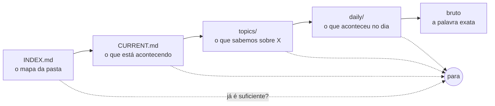

# Atlaz

**Memória em camadas em arquivos de texto, para agentes de IA acharem o que precisam rápido e barato.**


> *In English:* Atlaz is a convention plus a single-file Python tool that turns any folder of Markdown into layered, linked memory. An AI agent enters through the map, goes down one step at a time, and stops as soon as it has enough. Plain text, relative links, no database, no dependencies. Docs are in Portuguese.

<br>

## Por que existe

Um agente de IA que abre um projeto grande tem 2 jeitos ruins de trabalhar: ler tudo (caro e lento) ou buscar por palavra no escuro (acha pouco ou acha errado).

Pense em achar a casa de um parente numa cidade nova:

| Você tem | Você faz |
|---|---|
| o endereço | vai direto |
| só uma ideia | descarta o bairro industrial e procura no residencial |
| já foi várias vezes | vai pelo caminho que decorou |

**Endereço, lógica, hábito.** O Atlaz aplica isso a pastas e arquivos. Cada pasta tem um mapa. Cada mapa diz o que tem ali e quando vale abrir. O agente desce um degrau por vez e para quando tiver o suficiente.

<br>

## A escada de leitura



O bruto (mensagens, transcrições, código, PDFs) só entra quando há dúvida, conflito entre fontes, decisão importante ou quando é preciso citar a palavra exata.

<br>

## O que é, o que não é

| É | Não é |
|---|---|
| uma convenção: camadas, escada de leitura, índices, links e procedência | um banco de dados |
| uma ferramenta de um arquivo só que mantém a convenção e faz o lint | busca por significado (vetores) |
| barata: só texto e links relativos; funciona no GitHub, no Obsidian, no VS Code e em qualquer agente | quem decide o que é importante |

<br>

## Comece em 1 minuto

```bash
# 1. Copie a ferramenta para o seu projeto (é um arquivo só, sem dependências)
curl -O https://raw.githubusercontent.com/Thryki/Atlaz/main/ferramentas/atlaz.py

# 2. Veja o que ela faz, sem mexer em nada
python atlaz.py --help

# 3. Só verifique (não escreve nada)
python atlaz.py . --lint

# 4. Aplique: índices, links, "Veja também", linha do tempo e lint
python atlaz.py .

# 5. Busque por palavra, com o resultado ordenado pela escada
python atlaz.py . --buscar "termo"
```

Rodar 2 vezes no mesmo dia não muda mais nada: a ferramenta converge.

<br>

## O que a ferramenta faz

| Passo | O que gera ou confere |
|---|---|
| 1. Links | troca menções a arquivos `.md` por links markdown relativos |
| 2. Mapa | um `INDEX.md` por pasta: uma linha por arquivo, com **o que é** e **quando ler** |
| 3. Veja também | no fim de cada documento: para onde ele aponta e quem o cita |
| 4. Linha do tempo | um [TIMELINE.md](docs/TIMELINE.md) com as decisões por data (o segundo caminho de acesso) |
| 5. Estado | uma tabela no topo dos registros de decisão: id, título, estado e data |
| 6. Carimbo | índices, linha do tempo e tabelas de estado levam data e hash, para saber se estão velhos |
| 7. Lint | link quebrado, arquivo órfão, nome repetido, acento trocado por "?" e arquivo acima do tamanho da camada |

Códigos de saída: `0` tudo certo; `1` o lint achou erro (ou houve uma falha inesperada, como um `.md` fora de UTF-8); `2` uso errado, inclusive `atlaz.json` inválido (nesse caso nada foi escrito). Isso serve para CI e para hooks de commit.

**Seguro em repositório de terceiros:** a ferramenta só escreve dentro da pasta que você passou. Um `atlaz.json` com caminho para fora dela é recusado, e um `.md` que é link simbólico para fora não é reescrito.

<br>

## As regras, em uma tela

1. **Camadas com nomes fixos:** `INDEX.md`, `CURRENT.md`, `topics/`, `daily/` e o bruto.
2. **Escada de leitura:** de cima para baixo, parando assim que a resposta for suficiente.
3. **Mais de um caminho:** no mínimo por tema (as pastas) e por tempo (a linha do tempo).
4. **Procedência:** todo fato diz de onde veio, com que confiança e qual é a evidência.
5. **Nada se apaga:** fato novo aponta para o antigo, com data e motivo.
6. **Links relativos, nunca `[[wikilinks]]`:** o Obsidian lê os 2; o resto do mundo só lê o primeiro.
7. **Quem gera, edita:** índices e tabelas geradas não se editam à mão.

A especificação completa está na [SPEC.md](SPEC.md).

<br>

## Dois modos

| | Modo fonte | Modo cópia |
|---|---|---|
| Onde mora a verdade | no próprio markdown | num banco de dados |
| Editar o `.md` à mão | normal | proibido: o markdown é regenerado |
| Histórico | o git | o banco |
| Exemplo | um repositório de documentação | um assistente que guarda a memória das conversas num banco |

O projeto declara o modo no `atlaz.json`. Exemplo pronto em [exemplos/modo-fonte/](exemplos/modo-fonte/INDEX.md).

<br>

## Configuração

Tudo é opcional. Sem o `atlaz.json`, a ferramenta usa os padrões.

```json
{
  "modo": "fonte",
  "entradas": ["README.md", "AGENTS.md"],
  "nao_tocar": ["transcricao-bruta.md"],
  "descricoes": {"SPEC.md": ["as regras", "antes de mudar a convenção"]},
  "estado": ["docs/DECISION_LOG.md"],
  "orcamento": {"INDEX.md": 120, "*.md": 900}
}
```

Todas as opções estão na [SPEC.md, seção 14](SPEC.md).

<br>

## Para agentes de IA

Coloque no arquivo de instruções do agente do seu projeto:

```markdown
Antes de abrir arquivos inteiros, leia o INDEX.md da pasta.
Desça um degrau por vez: INDEX, CURRENT, topics, daily, bruto. Pare quando tiver o suficiente.
Rode `python atlaz.py .` antes de cada commit. Lint vermelho não vai para o commit.
```

Este repositório segue as próprias regras: veja o [AGENTS.md](AGENTS.md).

<br>

## Neste repositório

| Quero... | Vá para |
|---|---|
| as regras completas | [SPEC.md](SPEC.md) |
| adotar num projeto | [docs/ADOTAR.md](docs/ADOTAR.md) |
| saber por que é assim | [docs/ORIGEM.md](docs/ORIGEM.md) |
| ver as decisões e os motivos | [docs/DECISION_LOG.md](docs/DECISION_LOG.md) |
| a ferramenta | [ferramentas/atlaz.py](ferramentas/atlaz.py) |
| um exemplo | [exemplos/modo-fonte/](exemplos/modo-fonte/INDEX.md) |

<br>

## Licença

[MIT](LICENSE). Use, copie e adapte.

<br>

---

<sub>Feito pela [Iryx](https://www.iryxia.com), em Brasília. **Você decide. O Iryx também.**</sub>
